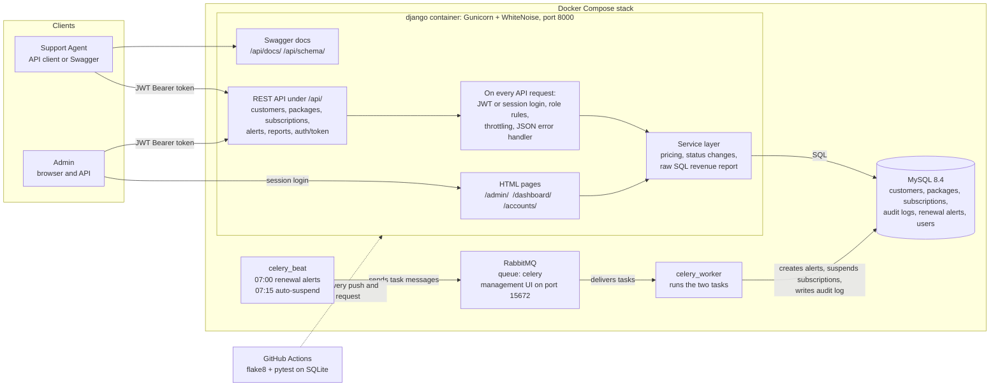
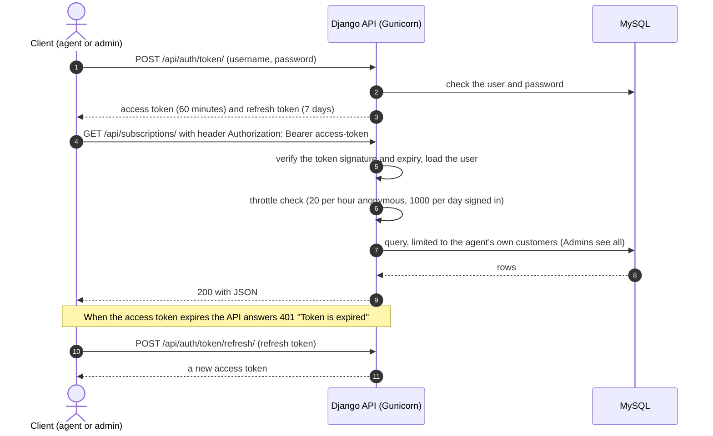
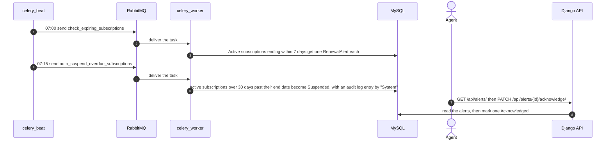

# System Architecture: ISP Subscription Management Platform

Five Docker Compose containers behind one public port. Django serves the HTML pages and the REST API, MySQL stores the data, and Celery (with RabbitMQ) runs the scheduled work in the background.

## 1. System overview

## 2. Login and an API request (JWT)

## 3. Scheduled tasks and alerts

## 4. Components

| Container | Image | Port | Job |
| --- | --- | --- | --- |
| `django` | built from `project/Dockerfile` | 8000 | Gunicorn runs the Django app. On start it migrates, loads seed data on first run, and collects static files. |
| `mysql` | `mysql:8.4` | none (3307 in dev) | All application data, stored in the `mysql_data` volume. |
| `rabbitmq` | `rabbitmq:3-management` | 15672 (UI) | Message broker. The `celery` queue carries task messages. |
| `celery_worker` | same image as `django` | none | Runs `alerts.tasks.check_expiring_subscriptions` and `subscriptions.tasks.auto_suspend_overdue_subscriptions`. |
| `celery_beat` | same image as `django` | none | Sends those two tasks to RabbitMQ on the schedule in settings (South African time). |

## 5. How the code is organised

| Layer | Where | Responsibility |
| --- | --- | --- |
| Routing | `project/urls.py`, `api/urls.py`, each app's `urls.py` | Web pages at the root, the whole API under `/api/` |
| Cross-cutting | `api/` (exceptions, docs), settings | JWT and session login, throttling, one JSON error shape, Swagger |
| Apps | `customers`, `packages`, `subscriptions`, `alerts`, `reports` | Models, serializers, viewsets, permissions |
| Business rules | `subscriptions/services.py` | Pricing, contract dates, status changes and the audit log |
| Reporting | `reports/queries.py` | The one raw SQL query, parameterised |
| Background work | `alerts/tasks.py`, `subscriptions/tasks.py` | The two Celery tasks |

## 6. Design decisions worth knowing

- **One image, three roles.** The web server, worker and beat run the same image with different commands, so they always run the same code.
- **Role scoping at the query.** Agents only ever get rows for their own customers. Admins (role `admin` or superuser) see everything.
- **Prices are frozen on the subscription.** Later changes to package or add-on prices do not alter existing contracts.
- **Tokens are stateless.** Nothing about a login is stored on the server. The `SECRET_KEY` signs the tokens, so it stays in `.env` and out of Git.
- **Tasks write straight to the database.** Celery uses the same Django models, so alerts created by the worker are what the API reads later. No HTTP call is involved.
- **Production and development modes.** `docker-compose.yml` runs Gunicorn with no code mounted. `docker-compose.dev.yml` adds `runserver`, a mounted code folder and the MySQL port.
