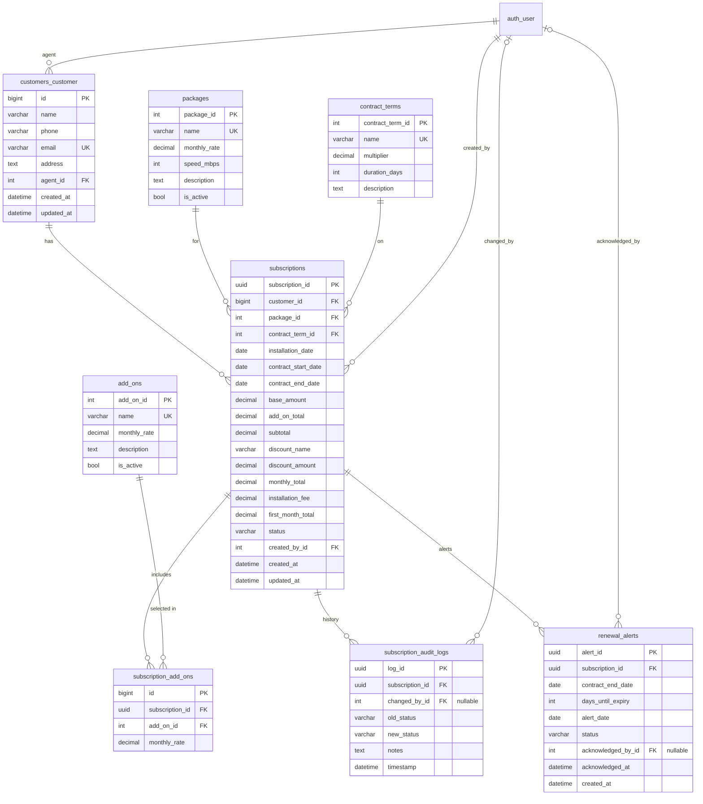

# Data Model & Design Decisions

ISP Subscription Management Platform (Project 2). This is the agreed source of truth for every `models.py`.
Change it only by team agreement and a reviewed PR.

## 1. Team decisions (gaps in the BRD)

| # | Topic | BRD says | We decided |
|---|-------|----------|------------|
| D1 | Discount eligibility | Lists 3 discounts, no eligibility rules | **Auto-calculated** by `PricingService`. New Customer = customer has no previous subscriptions. Loyalty = customer record is 12+ months old. Multi Add-On = 2 or more add-ons. Only the highest eligible discount applies (Loyalty 15% > New 10% > Multi 5%). |
| D2 | Renewal alert uniqueness | `subscription_id` UNIQUE | **Unique on (subscription, contract_end_date).** Gives one alert per contract cycle; renewed contracts can be alerted again. |
| D3 | Table names | `customers`, `subscriptions`, … | **BRD names** via `Meta.db_table` for packages, contract_terms, add_ons, subscriptions, subscription_add_ons, subscription_audit_logs and renewal_alerts. The customers table currently uses Django's default name `customers_customer` (no `db_table` set). |
| D4 | Install vs start date | Lists both | **Both columns.** Client sends `installation_date` only. Service sets `contract_start_date = installation_date` and `contract_end_date = start + duration_days`. |
| D5 | Audit log on Celery changes | `changed_by` FK | `changed_by` is **nullable**, because Celery has no user. Null means "System". |
| D6 | Deleting records | not specified | Customers, packages, terms and add-ons that are in use are **PROTECTED**. Cancel subscriptions instead of deleting them. |
| D7 | Customer email | format validation | Email is also **unique**. |
| D8 | Customer primary key | `customer_id` UUID | Customer uses Django's default auto-increment `id` (as built). Subscriptions link to it with a normal foreign key. |
| D9 | Package speeds | not specified | `speed_mbps`: Home Basic 10, Home Standard 25, Home Premium 50, Business Fibre 100. |

## 2. Entity relationship diagram



## 3. Indexes (BRD 13.1)

| Index | Why |
|-------|-----|
| `subscriptions.status` | List filtering and Celery tasks |
| `subscriptions.contract_end_date` | Expiry date-range queries |
| `subscriptions (status, contract_end_date)` | Composite: both Celery tasks filter on these two together |
| `subscriptions.customer_id` | FK, indexed automatically by MySQL |
| `renewal_alerts.status` | Alert list filtering |
| `customers_customer.agent_id` | FK, indexed automatically. Used for agent access (IDOR) filtering |
| `renewal_alerts (subscription_id, contract_end_date)` | Unique constraint (D2); also indexes the duplicate check |

## 4. Status values

Subscription: `Pending`, `Active`, `Suspended`, `Cancelled` (defined in `project/subscriptions/models.py` as `SubscriptionStatus`; import it).

Allowed transitions (BRD 8.1 + 18):

| From | To | Who |
|------|----|-----|
| Pending | Active, Cancelled | Admin |
| Active | Suspended, Cancelled | Admin; Celery (Active to Suspended only) |
| Suspended | Active, Cancelled | Admin only |
| Cancelled | none (final) | nobody |

Alerts: `Pending`, `Acknowledged`.

## 5. Seed data (BRD 8.1)

| Package | Monthly rate |
|---------|-------------|
| Home Basic | R399.00 |
| Home Standard | R699.00 |
| Home Premium | R999.00 |
| Business Fibre | R1 499.00 |

`speed_mbps` isn't in the BRD; the team chose 10 / 25 / 50 / 100 (D9). Loaded by `python manage.py seed_data` (`project/packages/management/commands/seed_data.py`). Running it twice creates no duplicates.

| Contract term | Multiplier | duration_days |
|---------------|-----------|---------------|
| Month-to-Month | 1.15 | 30 |
| 12-Month | 1.00 | 365 |
| 24-Month | 0.90 | 730 |

| Add-on | Monthly rate |
|--------|-------------|
| Static IP | R100.00 |
| Router Rental | R150.00 |
| LTE Failover SIM | R250.00 |

## 6. Pricing formula (implemented in `project/subscriptions/services.py`, not in views)

```
base_amount       = package.monthly_rate × contract_term.multiplier
add_on_total      = sum of selected add-on rates
subtotal          = base_amount + add_on_total
discount_amount   = subtotal × highest eligible discount %   (see D1)
monthly_total     = subtotal − discount_amount
first_month_total = monthly_total + 500.00
```

Round each money value to 2 decimal places using `Decimal`, never floats.

Worked example (use it as a test case): a new customer picks Home Standard on a 12-month contract with Static IP and Router Rental.
- base 699.00 × 1.00 = **699.00**; add-ons 100 + 150 = **250.00**; subtotal **949.00**
- Eligible: New Customer 10% and Multi Add-On 5%, so New Customer applies: discount **94.90**
- monthly **854.10**; first month **1 354.10**

> Check against Project 1: confirm the discount was applied to the **subtotal** (base + add-ons), not to the base only.

## 7. Ownership

| App | Owner | Merge order |
|-----|-------|-------------|
| customers | Siseko | 1 |
| packages | Cassidy | 2 |
| subscriptions | Cassidy | 3 |
| alerts | Khwezi | 4 |
| reports | Khwezi | (no models) |

Only the owner runs `makemigrations` for their app.

## 8. Open points for team review

- **Agent deletion:** `Customer.agent` uses `on_delete=CASCADE`, so deleting a staff user would try to delete their customers (blocked anyway once they have subscriptions, because subscriptions PROTECT customers). Suggest `PROTECT` to match D6.
- **Phone length:** `phone` is `max_length=10`; numbers with a `+27` prefix (12 characters) won't fit.
- **Discount base:** confirm against Project 1 that the discount applies to the subtotal (base + add-ons).
