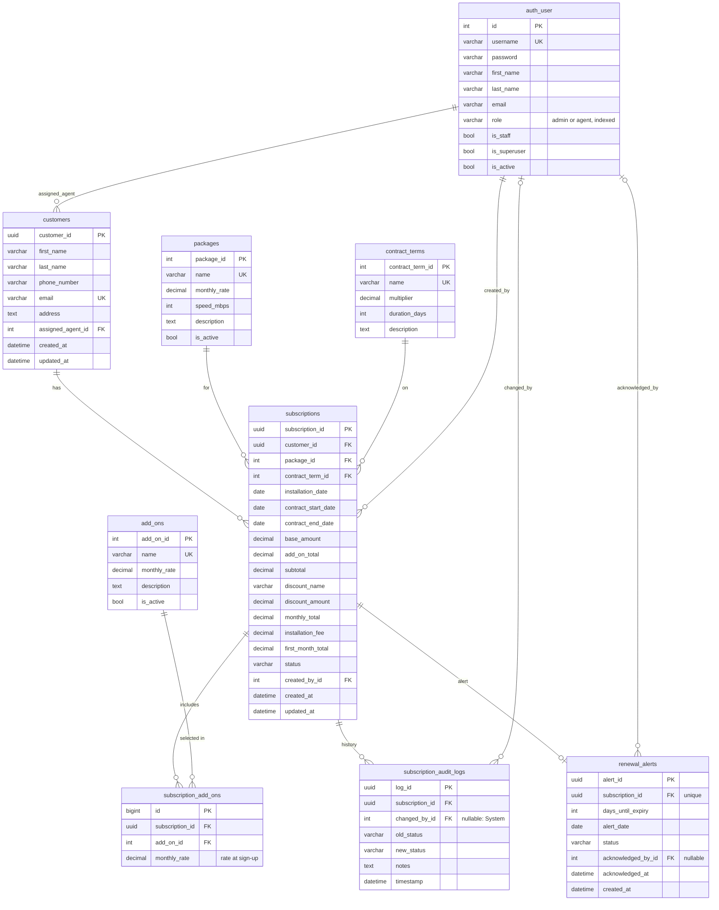

# Data Model & Design Decisions

ISP Subscription Management Platform (Project 2). This document describes the database **as built**
(every `models.py` in the project) and the decisions the team made where the BRD left a gap.
Change it only by team agreement and a reviewed PR.

## 1. Team decisions (gaps in the BRD)

| # | Topic | BRD says | We decided |
|---|-------|----------|------------|
| D1 | Discount eligibility | Lists 3 discounts, no eligibility rules | **Auto-calculated** by the pricing service. New Customer = customer has no previous subscriptions. Loyalty = customer record is 12+ months old. Multi Add-On = 2 or more add-ons. Only the highest eligible discount applies (Loyalty 15% > New Customer 10% > Multi Add-On 5%). |
| D2 | Renewal alert uniqueness | `subscription_id` UNIQUE | **As the BRD:** one alert per subscription (`OneToOneField`), so the daily task can never create duplicates. |
| D3 | Table names | `customers`, `subscriptions`, ... | **BRD names** via `Meta.db_table`, so the ERD and raw SQL match the BRD. |
| D4 | Install vs start date | Lists both | **Both columns.** The client sends `installation_date` only. The service sets `contract_start_date = installation_date` and `contract_end_date = start + duration_days`. |
| D5 | Audit log on Celery changes | `changed_by` FK | `changed_by` is **nullable**, because Celery has no user. Null is shown as "System". |
| D6 | Deleting records | Not specified | Customers, packages, terms, add-ons and agents that are in use are **PROTECTED**. Subscriptions are cancelled, never deleted. |
| D7 | Customer email | Format validation | Email is also **unique**, and saved in lower case. |
| D8 | Staff roles | Admin and Support Agent | A custom user model, `customers.User`, adds a **`role`** column (`admin` / `agent`). **Admin = role "admin" or superuser** (`user.can_view_all`). The role is kept in sync with the "Admin" and "Support Agent" groups. The table keeps the name `auth_user`. |
| D9 | Customer name | `full_name` | **`first_name` and `last_name`** columns, so lists can be sorted and searched by surname. `full_name` is a property, not a column. |
| D10 | Auto-suspension | "more than 30 days" past end date (section 5) | The Celery task suspends only **Active** subscriptions whose `contract_end_date` is **more than 30 days** in the past (30-day grace period). |
| D11 | Another agent's record | 403 | Every list is filtered by agent at queryset level. For single records: customers and alerts use an object permission and return **403**; subscriptions are looked up through the filtered queryset, so another agent's subscription returns **404** (its existence is not revealed). |

## 2. Entity relationship diagram



`auth_user` also has Django's standard columns (`last_login`, `date_joined`) and the
`auth_user_groups` link to `auth_group`, which are not shown.

## 3. Indexing strategy (BRD 13.1)

| Index | Type | Why |
|-------|------|-----|
| `subscriptions.status` | Single column | List filtering (`?status=`) and both Celery tasks |
| `subscriptions.contract_end_date` | Single column | Expiry date-range queries (dashboard, expiring report) |
| `subscriptions (status, contract_end_date)` | Composite, `idx_sub_status_end` | Both Celery tasks filter on these two together ("Active and ending soon" / "Active and overdue") |
| `subscriptions.customer_id`, `package_id`, `contract_term_id`, `created_by_id` | Foreign key (automatic) | Joins, and agent filtering via the customer |
| `subscription_add_ons (subscription_id, add_on_id)` | Unique, `uniq_sub_add_on` | Stops the same add-on being added twice; also indexes the lookup |
| `subscription_audit_logs.subscription_id` | Foreign key (automatic) | The audit log endpoint reads one subscription's history |
| `customers.assigned_agent_id` | Foreign key (automatic) | Agent access filtering (IDOR prevention) |
| `customers (last_name, first_name)` | Composite, `customers_name_idx` | Default ordering and name search |
| `customers.created_at` | Single column, `customers_created_idx` | Loyalty discount check (record 12+ months old) and ordering |
| `customers.email` | Unique | No duplicate customers; fast lookup by email |
| `renewal_alerts.subscription_id` | Unique (one-to-one) | One alert per subscription (D2); also the duplicate check in the daily task |
| `renewal_alerts.status` | Single column | Alert list filtering and the dashboard's pending count |
| `auth_user.role` | Single column | Permission checks read it on most requests |
| `packages.name`, `contract_terms.name`, `add_ons.name` | Unique | `seed_data` finds existing rows by name, so it can run more than once |

## 4. Status values

Subscription: `Pending`, `Active`, `Suspended`, `Cancelled` (defined in `subscriptions/models.py` as
`SubscriptionStatus`; import it, never retype the strings).

Allowed transitions (BRD 8.1 and 18):

| From | To | Who |
|------|----|-----|
| Pending | Active, Cancelled | Admin |
| Active | Suspended, Cancelled | Admin; Celery (Active to Suspended only, after the 30-day grace period) |
| Suspended | Active, Cancelled | Admin only |
| Cancelled | none (final) | nobody |

Every change goes through `change_status()` in `subscriptions/services.py`, which checks the rule and
writes the audit log entry.

Alerts: `Pending`, `Acknowledged` (defined in `alerts/models.py` as `RenewalAlert.Status`).

## 5. Seed data (BRD 8.1)

Loaded by `python manage.py seed_data`. Safe to run more than once.

| Package | Monthly rate | speed_mbps (our choice, not in the BRD) |
|---------|-------------|-----------------------------------------|
| Home Basic | R399.00 | 10 |
| Home Standard | R699.00 | 25 |
| Home Premium | R999.00 | 50 |
| Business Fibre | R1 499.00 | 100 |

| Contract term | Multiplier | duration_days |
|---------------|-----------|---------------|
| Month-to-Month | 1.15 | 30 |
| 12-Month | 1.00 | 365 |
| 24-Month | 0.90 | 730 |

| Add-on | Monthly rate |
|--------|-------------|
| Static IP | R100.00 |
| Router Rental | R150.00 |
| LTE Failover SIM | R250.00 |

## 6. Pricing formula (implemented in `subscriptions/services.py`, not in views)

```
base_amount       = package.monthly_rate × contract_term.multiplier
add_on_total      = sum of selected add-on rates
subtotal          = base_amount + add_on_total
discount_amount   = subtotal × highest eligible discount %   (see D1)
monthly_total     = subtotal − discount_amount
first_month_total = monthly_total + 500.00
```

Each money value is rounded to 2 decimal places using `Decimal`, never floats. Prices are calculated
on the server and stored on the subscription; anything the client sends for them is ignored.
Add-on rates are copied into `subscription_add_ons.monthly_rate`, so later price changes do not alter
existing subscriptions.

Worked example (also a test case): a new customer picks Home Standard on a 12-month contract with
Static IP and Router Rental.
- base 699.00 × 1.00 = **699.00**; add-ons 100 + 150 = **250.00**; subtotal **949.00**
- Eligible: New Customer 10% and Multi Add-On 5%, so New Customer applies: discount **94.90**
- monthly **854.10**; first month **1 354.10**

## 7. Ownership

| App | Owner | Contents |
|-----|-------|----------|
| customers | Siseko | `User` (role), `Customer` |
| packages | Cassidy | `Package`, `ContractTerm`, `AddOn`, `seed_data` |
| subscriptions | Cassidy | `Subscription`, `SubscriptionAddOn`, `SubscriptionAuditLog`, pricing and status services |
| alerts | Khwezi | `RenewalAlert`, `check_expiring_subscriptions` task |
| reports | Khwezi | No models: raw SQL revenue query, expiring report, staff dashboard view |

Only the owner runs `makemigrations` for their app.
